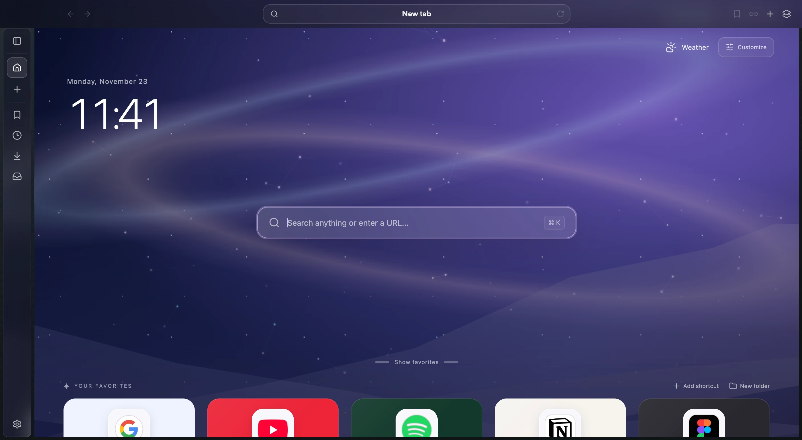

# NOVA

**Your beautiful browser.** NOVA is a Chromium-based browser for macOS with a slim vertical tab rail, search from anywhere, and a customizable start page.

[Download the macOS preview](https://github.com/Harshhexe/Nova/releases/tag/v1.0.0-preview.1) · [Explore NOVA](https://harshhexe.github.io/Nova/) · [Open the web dashboard](https://the-nova-web.vercel.app/)



## Install on macOS

The preview is built for **Apple Silicon Macs running macOS 13 or later**.

1. Download [NOVA-mac-arm64.dmg](https://github.com/Harshhexe/Nova/releases/download/v1.0.0-preview.1/NOVA-mac-arm64.dmg).
2. Open the disk image and drag **NOVA** into **Applications**.
3. Launch NOVA from Applications. The first run asks what to call you and walks through the dashboard, sidebar, and gestures.

The preview is ad-hoc signed and unnotarized. macOS may block it under your security policy. You can also run NOVA from source using the commands below.

## Browse with NOVA

- **Vertical tabs.** Navigate by site icon, drag up to three sites into sidebar Favorites, and choose which controls appear in the sidebar and toolbar.
- **Search from anywhere.** Press **⌘K** for search, website addresses, recent searches, and live suggestions when enabled.
- **Trackpad gestures.** Swipe with two fingers to go back or forward. Pinch in to open Tab Overview, then hover over a tab and pinch out to open it. Toggle each gesture in Browser Settings.
- **Your dashboard.** Pick an animated wallpaper, set your weather city, and organize shortcuts into folders.
- **Browser essentials.** Use private windows, find-in-page with match navigation, download controls, per-site permissions, saved logins and autofill, or built-in ad and tracker blocking with site exceptions.
- **Updates.** In Preview 2 and later, an icon appears above Settings when a newer version is available. Click it and choose **Update and relaunch** to install.
- **Media controls.** Hover over the playing media tile above Settings for artwork, playback controls, and a seekable timeline when the site exposes them.

| Shortcut | Action |
| --- | --- |
| **⌘K** | Open search |
| **⌘T** | New tab |
| **⌘⇧N** | New private window |
| **⌘⇧S** | Toggle sidebar |
| **⌘⇧\** | Show Tab Overview |

### Passkeys in the macOS preview

The preview cannot use website passkeys saved in Apple Passwords. If GitHub reports partial passkey support, open [GitHub’s passkey sign-in](https://github.com/login?passkey=true) in Safari. To sign in inside NOVA, use your password and an already configured second factor. Each browser has its own session.

NOVA’s saved logins are encrypted locally with Electron’s OS-backed storage. Support for Apple Passwords across websites requires [Apple’s managed browser entitlement](https://developer.apple.com/documentation/bundleresources/entitlements/com.apple.developer.web-browser.public-key-credential) and an implementation that uses the browser authorization APIs.

## Use the dashboard in Chrome

Install [New Tab Redirect](https://chromewebstore.google.com/detail/new-tab-redirect/icpgjfneehieebagbmdbhnlpiopdcmna?hl=en-US). In Chrome, open **Extensions → New Tab Redirect → Extension options**, set the redirect URL to `https://the-nova-web.vercel.app/`, and save. Use a single extension to control new tabs.

Dashboard shortcuts, folders, and preferences stay in the browser profile under that URL. Uploaded wallpapers are stored locally in IndexedDB. Export your setup from **Customize → Privacy & Data** before clearing site data or moving to a different browser profile. Suggestions and weather use network services when enabled.

## Run from source

Use Node.js 22 or newer. The desktop build and packaging commands require macOS with Xcode Command Line Tools.

```sh
npm ci
npm run browser       # Build and open the desktop browser
npm run package:mac   # Build a preview DMG in release/
npm test              # Run the project tests
```

Run `npm run dev` for the Vite dashboard and `npm start` for its local suggestions server. `npm run build` writes the web bundle to `dist/`. Vercel deployments use the serverless handler at `api/suggest.js` as well as the web bundle. `npm run package:extension` builds the standalone new-tab extension.

The launch site lives in `docs/` and publishes to GitHub Pages. Preview it locally with `python3 -m http.server 4181 --directory docs`.

Desktop updates use GitHub Releases. Match the release tag to the packaged version, such as `v1.0.0-preview.2`, and attach the `NOVA-mac-arm64.dmg` produced by the build.
